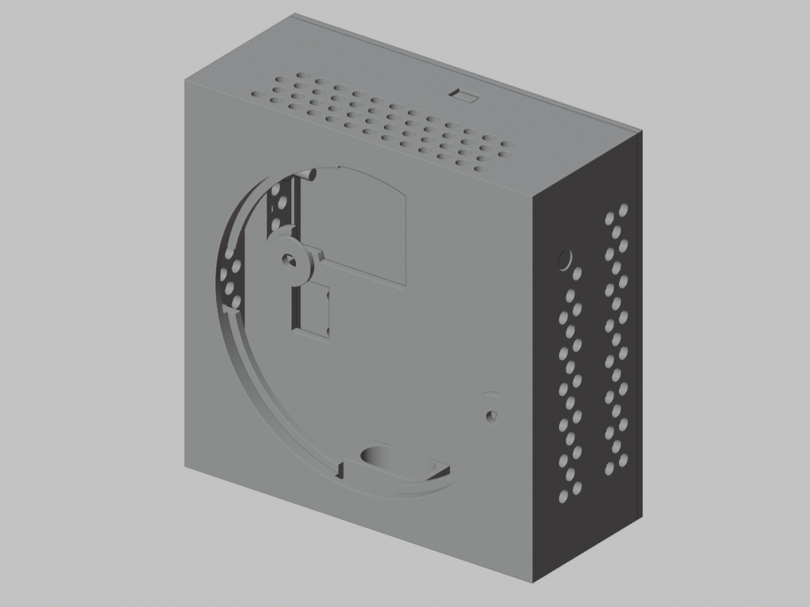
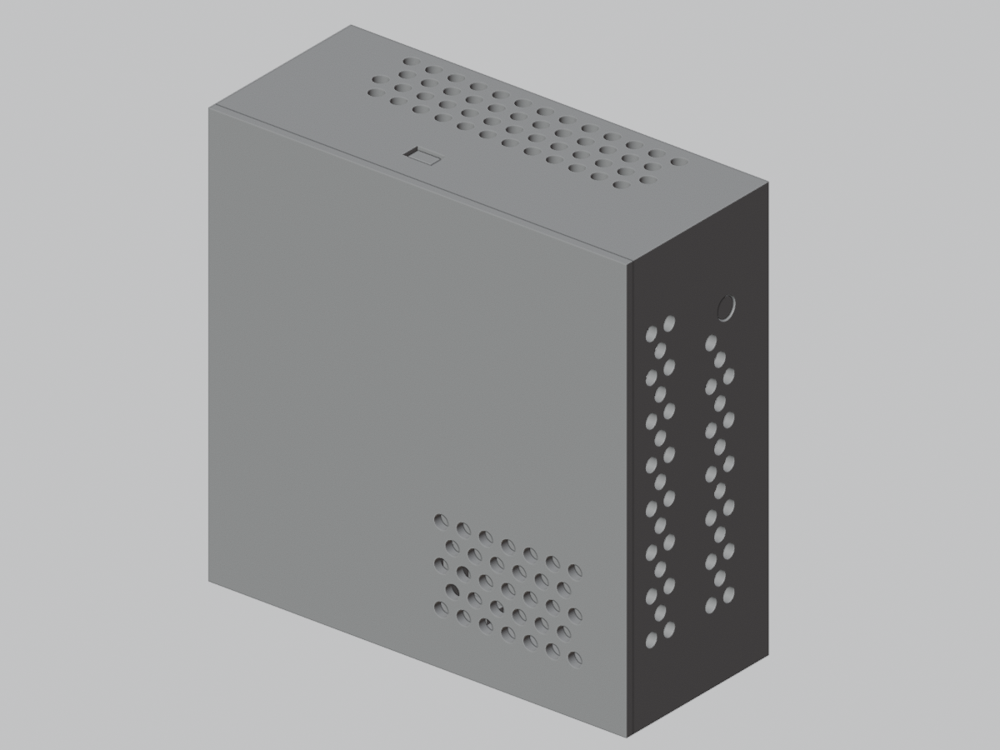
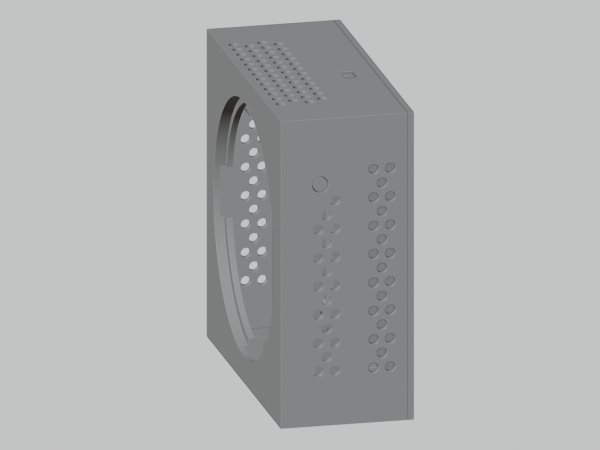

# ESP32-S3 Touch AMOLED 1.75" enclosure

A parametric, 3D-printable enclosure for the
[Waveshare ESP32-S3-Touch-AMOLED-1.75](https://www.waveshare.com/wiki/ESP32-S3-Touch-AMOLED-1.75)
round display board. The whole model is generated from Python inside Blender,
so every dimension and print allowance is a named constant you can change and
regenerate. No Blender project file is needed.

| Front | Rear | Side buttons |
| :---: | :---: | :---: |
|  |  |  |

> **Just want to print it?** Download the ready-made STLs from
> [`models/`](models/) and read the [printing and assembly guide](docs/printing-and-assembly.md).
> You only need Blender if you want to change the design.

## Features

- Compact 60 × 60 × 13.5 mm hollow shell with 1.2 mm walls.
- Stepped display seat (2.05 mm deep) with a PCB opening, cable reliefs on all
  four sides, and an optional vertical-radius compensation for upright prints.
- Three M2 screw access holes with recessed heads and short inward risers.
- Cutouts for the 8-pin header, speaker and battery connectors, both
  microphones, and a rounded USB-C opening with an internal guide tunnel.
- Rear component tray with corner holders for a 22 × 53 mm battery,
  30 × 30 mm GPS module, and 30 × 20 mm speaker, plus a 24 × 24 mm GPS window.
- Separate flat rear cover with a speaker grille, internal locating rails, and
  two snap clips. The outside is flush, with no raised latches.
- Staggered airflow vents in the sides and top.
- Two guided, recessed side buttons for the board's upper switches. Each
  plunger is a separate printable part installed from inside the shell.
- An optional simplified hardware model for checking fit in Blender. It is
  never exported to STL.

## Quick start

### Option A: print the supplied STLs

1. Take the shell, flush cover, and both button STLs from [`models/`](models/).
2. Follow [docs/printing-and-assembly.md](docs/printing-and-assembly.md).
3. Print a small fit test first. Printer tolerances vary.

### Option B: generate the model yourself

Requirements: [Blender](https://www.blender.org/download/). The model is
built and tested with Blender 5.2 LTS. The code also contains fallbacks for the
older STL exporter and Boolean solver names, but older versions are untested.

From the repository root:

```sh
blender --background --python blender_enclosure.py -- --export
```

This writes the following to the git-ignored `output/` directory (building
takes a few minutes because of the many exact Boolean operations):

```text
output/
  esp32_s3_touch_amoled_1_75_enclosure.blend
  esp32_s3_touch_amoled_1_75_enclosure.stl
  esp32_s3_touch_amoled_1_75_flush_cover.stl
  esp32_s3_touch_amoled_1_75_left_button.stl
  esp32_s3_touch_amoled_1_75_right_button.stl
```

Use `--output-dir PATH` for another location. Relative paths resolve from the
repository root. Without `--export`, the script only builds the scene.

You can also open `blender_enclosure.py` in Blender's **Scripting** workspace
and press **Run Script**, or use the VS Code *Blender Development* extension.

## Customising

Open [`esp32_enclosure/config.py`](esp32_enclosure/config.py), change values in
the **USER PARAMETERS** section (millimetres), and rerun. The most useful ones:

| Parameter | Default | Purpose |
| --- | ---: | --- |
| `MIN_CASE_DEPTH` | 13.5 | Main shell depth |
| `ENCLOSURE_THICKNESS` | 1.2 | Shell, rear wall, cover, display support |
| `DISPLAY_DIAMETRAL_CLEARANCE` | 0.4 | Clearance around the display glass |
| `BOARD_DIAMETRAL_CLEARANCE` | 0.7 | Clearance around the Ø46 mm PCB |
| `DISPLAY_VERTICAL_RADIUS_COMPENSATION` | 0.2 | Extra vertical radius for upright printing |
| `SCREW_WELL_DEPTH_REDUCTION` | 1.0 | Leaves 0.9 mm inward screw risers |
| `USB_C_CENTRE_FROM_FRONT` | 9.2 | USB-C cutout center from the display face |
| `BASE_MIC_CENTRE_FROM_FRONT` | 9.2 | Two bottom mic-hole centers from the display face |
| `ACCESSORY_INTERNAL_DEPTH` | 10.8 | Space from middle wall to rear cover |
| `ACCESSORY_SNAP_CLIP_THICKNESS` | 1.1 | Flexible rear-cover clip beam |
| `ACCESSORY_SNAP_WALL_CLEARANCE` | 0.15 | Gap between clips and tray walls |
| `SWITCH_REST_GAP` | 0.0 | Button tip gap to the measured switch envelope |
| `ENABLE_SIDE_SWITCH_BUTTONS` | `True` | Generate the two guides and loose plungers |
| `ENABLE_*` | varies | Switch features such as vents, tunnel, cover clips, fit-check model |

The script validates parameters before building and raises a descriptive error
if a combination is impossible (for example, a pocket larger than the case).
See [docs/development.md](docs/development.md) for the code layout.

### Preview renders

```sh
blender --background --python scripts/render_preview.py
```

This regenerates the front, rear, and side-button images in `docs/images/`.

## Things to check before you print

- **Rear chamber depth.** The tray is 10.8 mm deep, while the accessory
  height is specified as 12 mm. A rigid 12 mm module will interfere with the
  cover. Measure your parts and raise `ACCESSORY_INTERNAL_DEPTH` if needed.
- **Microphone ports.** Their centres are estimated from the drawing, not
  dimensioned. Verify against your board.
- **USB-C plug.** Test the opening with your actual cable head.
- **Tolerances.** The allowances are a first-print starting point, not a
  guarantee for any printer or material.

The measured dimensions, coordinate system and allowances are documented in
[docs/geometry.md](docs/geometry.md).

## Repository layout

```text
blender_enclosure.py     Entry script (Blender Run Script / command line)
esp32_enclosure/         Generator package (config, geometry, export)
scripts/                 Preview-render helper
models/                  Pre-generated STL files
docs/                    Geometry notes, printing guide, development notes
```

## Hardware reference files

This repository does not redistribute Waveshare's CAD/PDF files. Download the
board's drawings and STEP model from the
[Waveshare wiki](https://www.waveshare.com/wiki/ESP32-S3-Touch-AMOLED-1.75) if
you want to re-check the measurements in [docs/geometry.md](docs/geometry.md).
The generator itself does not need them.

## Contributing

Issues and pull requests are welcome, especially fit reports from real prints
(printer, material, and what needed adjusting). Please keep the exported model
stable unless a change is intended, and describe any geometry change in the
pull request. See [docs/development.md](docs/development.md).

## Disclaimer

This is an independent community project. It is not affiliated with or endorsed
by Waveshare or Espressif. The enclosure is provided as is; check fit and
electrical clearances yourself, especially around batteries.

## License

[MIT](LICENSE). The license covers the code, documentation, and generated
models in this repository. Waveshare's hardware designs remain theirs.
